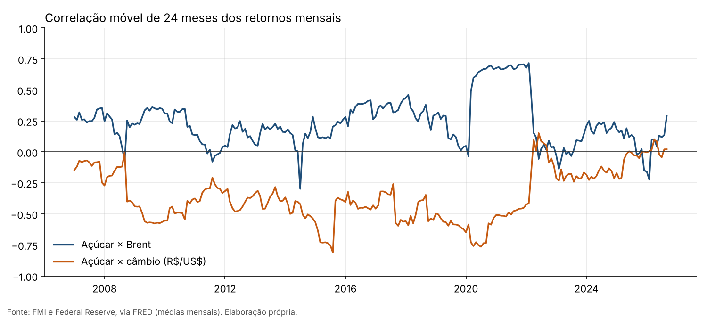

🇧🇷 [Português](README.md) | 🇺🇸 **English**

# Commodity fundamentals: sugar

A Python study of what drives international sugar prices, seen from Brazil, the world's largest exporter. It downloads public series from FRED, stores them in SQLite, measures how sugar moves with oil and the Brazilian real and computes the ethanol–sugar parity, with a CLI (`argparse`), SQL queries and tests.

## Commands

| Command | What it does | Example usage |
|---|---|---|
| `relatorio` | Downloads No. 11 sugar and Brent (IMF) and BRL per USD (Fed) from FRED, stores them in SQLite, computes a rolling correlation and a regression of monthly returns, and writes charts and a Markdown summary | `python -m fundamentos relatorio --inicio 2005-01` |
| `paridade` | Computes the sugar price (c/lb) that pays for ATR as well as ethanol does, and sugar's premium over ethanol | `python -m fundamentos paridade --etanol 2800 --cambio 5.40 --acucar 18.5` |

## Hypotheses

| Variable | Mechanism | Expected sign |
|---|---|---|
| Oil | Expensive gasoline makes ethanol more competitive, so more cane goes to ethanol and less sugar is made | Positive |
| BRL per USD | A weaker real raises exporters' revenue in reais and encourages selling | Negative |

## Sample output

The [`relatorios/`](relatorios/) folder holds the real output of `relatorio`, with monthly data from Jan 2005 to Sep 2026: the [summary](relatorios/resumo.md) (in Portuguese) and the charts. Key findings:

- Both expected signs show up: monthly sugar returns correlate +0.29 with Brent and −0.36 with BRL per USD.
- In the regression, a 1% rise in the dollar against the real comes with a 0.6% fall in sugar in the same month, on average; a 1% rise in Brent comes with a 0.13% rise (R² = 0.15).
- The relationships shift over time: the rolling FX correlation averaged −0.48 from 2009 to 2021 but has stayed between −0.24 and +0.10 since mid-2022; the Brent correlation rose from −0.22 in February to +0.29 in September 2026.



## Installation

```bash
git clone https://github.com/kagenash/commodities-fundamentos.git
cd commodities-fundamentos
pip install -r requirements.txt
```

Requires Python 3.10+. Downloaded CSVs and the SQLite file live in `dados/`, outside Git; with no connection, `--offline` reuses the CSVs already downloaded.

## Tests

Unit conversions, parity, FRED parsing, the regression, the SQL query and the CLI have unit tests on synthetic data:

```bash
pytest -v
```

## Ethanol–sugar parity

```text
parity (c/lb) = ethanol (R$/m³) × 1.0453 / (ethanol ATR factor × BRL per USD × 22.0462)
```

ATR factors used by UNICA: 1.0453 kg per kg of VHP sugar; 1.6761 kg per litre of hydrous ethanol and 1.7492 per litre of anhydrous. Simplified: mill-gate ethanol price net of taxes, with no freight, port elevation or polarization premium.

## Limitations and next steps

Monthly IMF averages rather than daily ICE settlements, released with a lag of a few weeks; correlation is not causation, hence the rolling window and robust standard errors. Next: read UNICA's fortnightly crush reports (cane, ATR, mix) and estimate Centre-South output (cane × ATR × mix ÷ 1.0453), towards a supply and demand balance.

## License

MIT — use, adapt and share freely.
