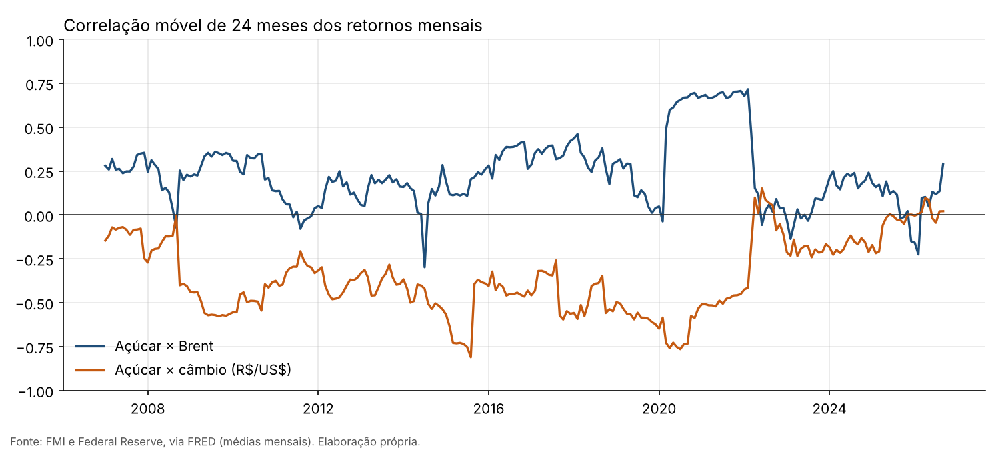

🇧🇷 **Português** | 🇺🇸 [English](README.en.md)

# Fundamentos de commodities: açúcar

Estudo em Python sobre o que move o preço internacional do açúcar, olhando para o Brasil, maior exportador do mundo. Baixa séries públicas do FRED, guarda tudo em SQLite, mede a relação do açúcar com o petróleo e o câmbio, calcula a paridade entre etanol e açúcar e estima a produção de açúcar a partir de cana, ATR e mix, com CLI (`argparse`), consultas SQL e testes.

## Comandos

| Comando | O que faz | Exemplo de uso |
|---|---|---|
| `relatorio` | Baixa do FRED o açúcar nº 11 e o Brent (FMI) e o câmbio R$/US$ (Fed), grava em SQLite, calcula correlação móvel e regressão dos retornos mensais e gera gráficos e um resumo em Markdown | `python -m fundamentos relatorio --inicio 2005-01` |
| `paridade` | Calcula o preço do açúcar (c/lb) que remunera o ATR igual ao etanol e o prêmio do açúcar sobre o etanol | `python -m fundamentos paridade --etanol 2800 --cambio 5.40 --acucar 18.5` |
| `producao` | Estima a produção de açúcar a partir da cana moída, do ATR e do mix (os números do acompanhamento quinzenal da UNICA) | `python -m fundamentos producao --cana 600 --atr 138 --mix 52` |

## Hipóteses testadas

| Variável | Mecanismo | Sinal esperado |
|---|---|---|
| Petróleo | Gasolina cara deixa o etanol mais competitivo; mais cana vai para o etanol e sai menos açúcar | Positivo |
| Câmbio (R$/US$) | Real fraco aumenta a receita em reais do exportador e estimula as vendas | Negativo |

## Exemplos de saída

A pasta [`relatorios/`](relatorios/) contém a saída real do comando `relatorio`, com dados mensais de jan/2005 a set/2026: o [resumo](relatorios/resumo.md) e os gráficos. Os principais achados:

- Os dois sinais esperados aparecem: a correlação dos retornos mensais do açúcar é de +0,29 com o Brent e de −0,36 com o câmbio.
- Na regressão, 1% de alta do dólar contra o real vem, em média, com 0,6% de queda do açúcar no mesmo mês; 1% de alta do Brent vem com 0,13% de alta (R² = 0,15).
- A relação muda com o tempo: a correlação móvel com o câmbio, em média −0,48 entre 2009 e 2021, ficou entre −0,24 e +0,10 desde meados de 2022; a do Brent subiu de −0,22 em fevereiro para +0,29 em setembro de 2026.



## Instalação

```bash
git clone https://github.com/kagenash/commodities-fundamentos.git
cd commodities-fundamentos
pip install -r requirements.txt
```

Requer Python 3.10+. Os CSVs baixados e o SQLite ficam em `dados/`, fora do Git; sem internet, `--offline` usa os CSVs já baixados.

## Testes

Conversões de unidade, paridade, estimativa de produção, leitura do FRED, regressão, consulta SQL e CLI têm testes unitários com dados sintéticos:

```bash
pytest -v
```

## Paridade etanol x açúcar

A usina decide o mix comparando quanto cada produto paga pelo ATR (açúcar total recuperável):

```text
paridade (c/lb) = etanol (R$/m³) × 1,0453 / (coeficiente do etanol × câmbio × 22,0462)
```

- 1,0453 kg de ATR por kg de açúcar VHP; 1,6761 kg de ATR por litro de etanol hidratado e 1,7492 por litro de anidro (coeficientes usados pela UNICA).
- 22,0462 converte US$/t em c/lb.
- Versão simplificada: usa o preço do etanol na usina, sem impostos, e não desconta os custos de exportação do açúcar (frete e porto).

## Estimativa de produção

Com a cana moída, o ATR e o mix, números que a UNICA divulga a cada quinzena, dá para estimar quanto açúcar a safra produz:

```text
açúcar (mi t) = cana (mi t) × ATR (kg/t) × mix ÷ 1,0453 ÷ 1.000
```

- O mix entra em fração (52% = 0,52): é a parte do ATR que vai para o açúcar.
- Exemplo: 600 milhões de t de cana, ATR de 138 kg/t e mix de 52% dão cerca de 41,2 milhões de t de açúcar VHP.

## Estrutura

```
commodities-fundamentos/
├── fundamentos/
│   ├── fontes.py          # download e cache das séries (FRED)
│   ├── conversoes.py      # unidades, paridade e estimativa de produção
│   ├── analise.py         # retornos, correlação móvel e regressão
│   ├── banco.py           # SQLite e execução das consultas
│   ├── relatorio.py       # gráficos e resumo em Markdown
│   └── __main__.py        # CLI
├── sql/
│   └── variacao_mensal.sql
├── tests/
├── relatorios/
├── requirements.txt
└── README.md
```

## Limitações e próximos passos

- São médias mensais do FMI, não fechamentos diários da ICE, e a série sai com algumas semanas de atraso.
- Correlação não é causalidade: os números mostram o que costuma andar junto no mesmo mês, não o que causa o quê.
- Próximo passo: ler automaticamente o acompanhamento quinzenal da UNICA (moagem, ATR, mix) para alimentar a estimativa de produção e montar um balanço de oferta e demanda.

## Fontes

- FRED: [PSUGAISAUSDM](https://fred.stlouisfed.org/series/PSUGAISAUSDM), [POILBREUSDM](https://fred.stlouisfed.org/series/POILBREUSDM), [EXBZUS](https://fred.stlouisfed.org/series/EXBZUS)
- UNICA: [coeficientes de conversão do ATR](https://unicadata.com.br/arquivos/pdfs/2025/05/e647d9c8d569120eb3dae2234e1cc103.pdf)

## Licença

MIT — use, adapte e compartilhe à vontade.
