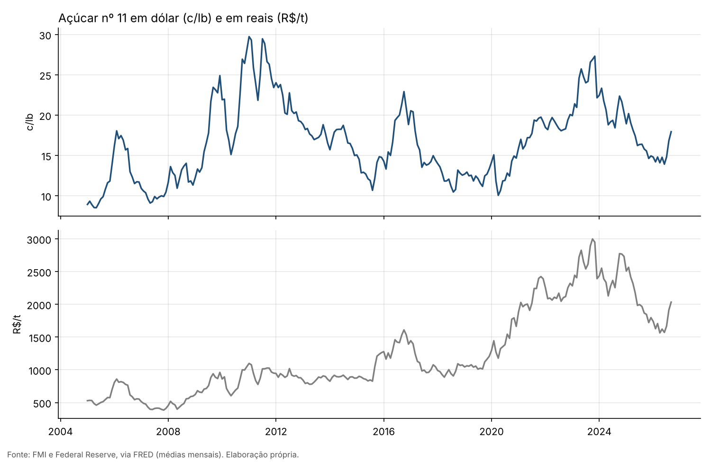
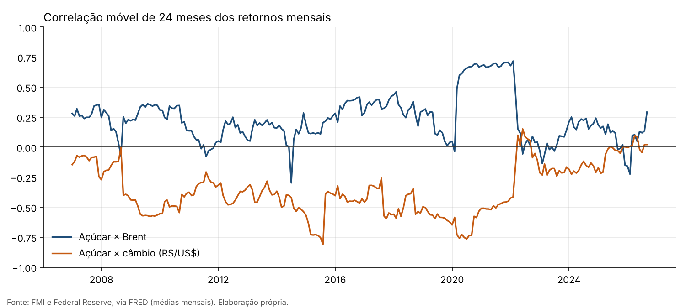

# Resumo do estudo

Período analisado: 2005-01 a 2026-09 (261 meses). Gerado com `python -m fundamentos relatorio`.

## Último mês disponível (2026-09)

| Indicador | Valor |
| --- | --- |
| Açúcar nº 11 | 17,94 c/lb (396 US$/t) |
| Açúcar em reais | R$ 2.034/t |
| Variação do açúcar em 12 meses | 13,6% |
| Petróleo Brent | US$ 102,02/barril |
| Câmbio | R$ 5,14 por US$ |

## Açúcar, petróleo e câmbio

Correlação dos retornos mensais no período todo: açúcar × Brent = 0,29; açúcar × câmbio = -0,36.
Na janela móvel de 24 meses, o valor mais recente é 0,29 (Brent) e 0,02 (câmbio).

Regressão (MQO) do retorno mensal do açúcar contra o Brent e o câmbio:

| Variável | Coeficiente | Erro-padrão | p-valor |
| --- | --- | --- | --- |
| Constante | 0,004 | 0,004 | 0,371 |
| Brent | 0,127 | 0,051 | 0,013 |
| Câmbio (R$/US$) | -0,615 | 0,132 | 0,000 |

R² = 0,15; N = 260 meses. Como os retornos estão em log, um coeficiente de 0,10 indica que 1% de alta na variável vem, em média, com 0,10% de alta no açúcar no mesmo mês.

## Últimos 6 meses (consulta em `sql/variacao_mensal.sql`)

| Mês | c/lb | R$/t | Var. no mês | Var. em 12 meses |
| --- | --- | --- | --- | --- |
| 2026-04 | 14,09 | 1.564 | -4,8% | -22,5% |
| 2026-05 | 14,77 | 1.622 | 4,8% | -15,3% |
| 2026-06 | 13,91 | 1.571 | -5,8% | -14,3% |
| 2026-07 | 14,81 | 1.668 | 6,5% | -9,5% |
| 2026-08 | 16,83 | 1.913 | 13,6% | 2,7% |
| 2026-09 | 17,94 | 2.034 | 6,6% | 13,6% |

